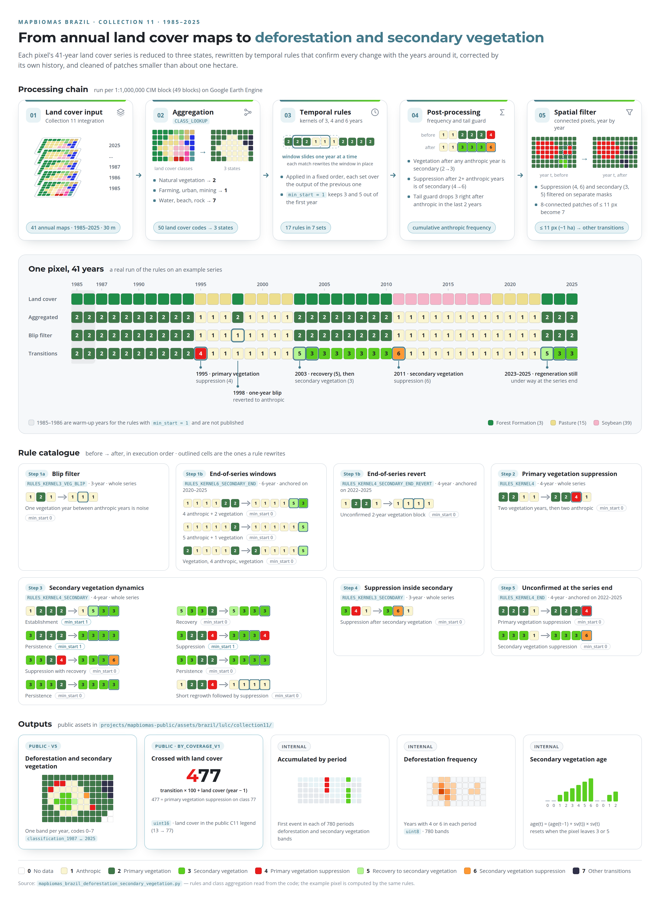

# Collection 11 — Deforestation and Secondary Vegetation

MapBiomas Brazil Collection 11 pipeline (1985–2025 series), in Python, on the Google Earth Engine
API. It replaces the JavaScript scripts of [Collection 9](../collection9/).

| File | What it is |
|---|---|
| [`mapbiomas_brazil_deforestation_secondary_vegetation.py`](mapbiomas_brazil_deforestation_secondary_vegetation.py) | Pipeline: configuration, rules, spatial filter and export of every product |
| [`deforestation_secondary_vegetation.py`](deforestation_secondary_vegetation.py) | Class that applies the temporal window rules (3-, 4- and 6-year kernels) |
| [`tests/test_rules.py`](tests/test_rules.py) | Offline tests of the rule semantics |
| [`docs/temporal-rules.md`](docs/temporal-rules.md) | The rules, the order they run in, and the behavior at the end of the series |
| [`docs/products.md`](docs/products.md) | Products generated, pixel encoding and public assets |

## The method on one page

<picture>
  <source media="(prefers-color-scheme: dark)" srcset="docs/figures/method-dark.png">
  <source media="(prefers-color-scheme: light)" srcset="docs/figures/method-light.png">
  
</picture>

The figure is generated by [`docs/figures/build_method_figure.py`](docs/figures/build_method_figure.py),
which reads the rules and the class aggregation from the pipeline source and runs the example pixel
through the same rules. Regenerate it after changing any rule (needs Google Chrome):
`python docs/figures/build_method_figure.py`.

1. **Aggregation.** The land cover classes of the C11 integration map become three states:
   anthropic (1), vegetation (2) and other (7). The table is `CLASS_LOOKUP`.
2. **Temporal rules.** Sliding windows of 3, 4 and 6 years rewrite each pixel's series: primary
   vegetation suppression (4) requires confirmation by two anthropic years; secondary vegetation
   (3) requires three years of vegetation after anthropic use, and the recovery year is marked 5;
   secondary vegetation suppression is 6.
3. **Frequency correction.** Vegetation on a pixel that was once anthropic is secondary, not
   primary.
4. **End of the series.** The last years have no following years to confirm anything. Anchored
   6-year windows detect ongoing regeneration, and a tail guard removes unconfirmed secondary
   vegetation.
5. **Spatial filter.** Patches of up to 11 pixels (~1 ha), year by year, become "other
   transitions" (7).
6. **Derived products.** Annual crossed with land cover, accumulated by period, deforestation
   frequency and secondary vegetation age.

What changed since Collection 9: `min_start` is mandatory in every rule (avoids spurious secondary
vegetation in 1985–1986), anchored end-of-series windows, a one-year blip filter, an anchored
revert of two-year blocks, and a year-by-year spatial filter. The history is in
[temporal-rules.md §11](docs/temporal-rules.md#11-history-of-resolved-problems).

## Published data

| Asset (`projects/mapbiomas-public/assets/brazil/lulc/collection11/`) | Period |
|---|---|
| `mapbiomas_brazil_collection11_deforestation_secondary_vegetation_v5` | 1987–2025 |
| `mapbiomas_brazil_collection11_deforestation_secondary_vegetation_by_coverage_v1` | 1987–2025 |

Details, encoding and a usage example in [docs/products.md](docs/products.md).

## How to run

```bash
python -m venv .venv && source .venv/bin/activate
pip install -r ../requirements.txt

# rule tests: offline, no credentials needed
python -m pytest tests -v

# pipeline: requires write access to the mapbiomas-brazil project
earthengine authenticate
EE_PROJECT=mapbiomas-brazil python mapbiomas_brazil_deforestation_secondary_vegetation.py
```

All `RUN_*` flags ship turned off: the C11 round (`0-4-14-c84-5-2`) is already materialized, and
the export skips existing assets. For a new round, bump `VERSION_OUTPUT_*` and turn the steps on in
the order described in [docs/products.md](docs/products.md#1-processing-chain).

## Origin

Code copied from MapBiomas' internal pipeline repository (`mapbiomas-pipeline`, commit `c50594f`,
2026-10-15). Rules and processing are the same; only the imports, the Earth Engine project
(`EE_PROJECT` variable) and the Brazil grid, now embedded in the script, changed. Code comments
were translated to English.
